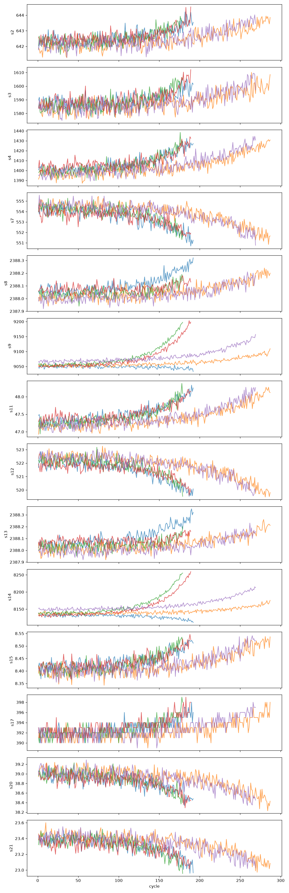
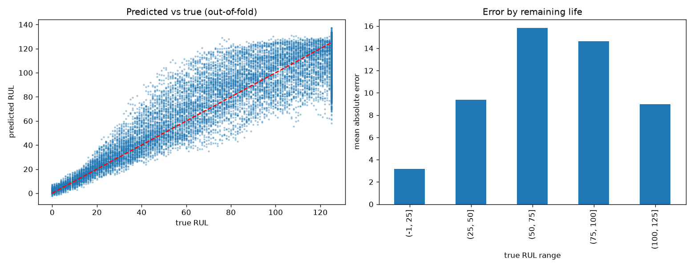
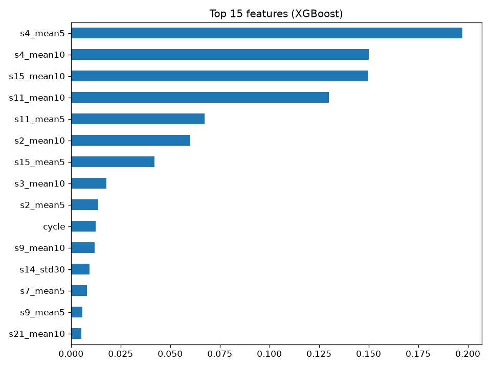
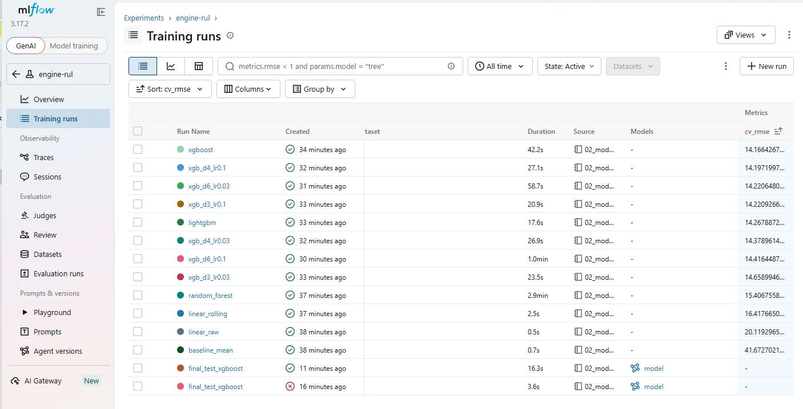
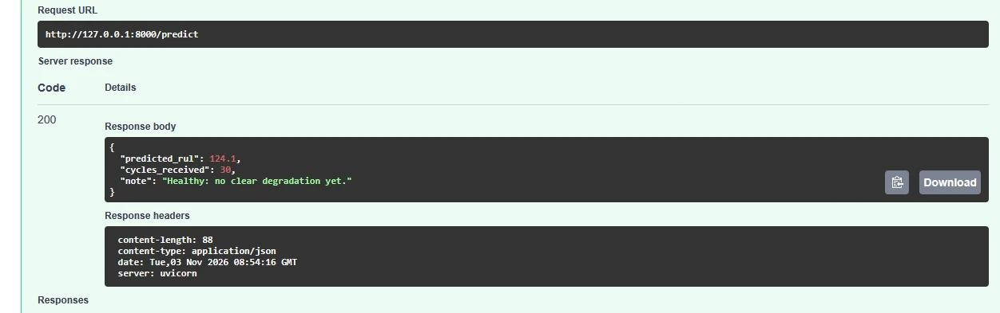

# Engine Failure Prediction: Remaining Useful Life of Turbofan Engines


Predicting how many cycles a jet engine has left before failure from its sensor readings, using the NASA C-MAPSS dataset. The final model predicts remaining life **within about 15 cycles on unseen engines, 65% better than a naive baseline**, and is served as a REST API in Docker.

    

## Problem

Airlines want to service an engine **just before** it fails. Servicing too early wastes parts that still have life left; servicing too late is dangerous and grounds the aircraft. The goal is to predict the **Remaining Useful Life (RUL)**: the number of operating cycles (roughly, flights) an engine has left, from its sensor history. This is a regression task, and the same idea as condition-based maintenance in power systems and manufacturing.

## Data

[NASA C-MAPSS turbofan engine degradation dataset](https://www.kaggle.com/datasets/behrad3d/nasa-cmaps), subset **FD001** (one operating condition, one fault mode):

- **Training set:** 100 engines run until failure, 20,631 rows (one row = one engine at one cycle), 3 operating settings and 21 sensors.
- **Test set:** 100 different engines stopped at some point before failure, plus the true RUL at their last cycle.

Data is not stored in this repo. Download `train_FD001.txt`, `test_FD001.txt` and `RUL_FD001.txt` into `data/`.

## Approach

1. **Exploratory analysis:** removed 10 columns with (almost) no variation (3 operating settings and 7 flat sensors), keeping 14 informative sensors. Plotted sensor trends: several sensors drift steadily as engines approach failure.
2. **Target:** RUL = last cycle of the engine minus current cycle, **capped at 125**. Early in life sensors look flat, so "190 cycles left" cannot be told apart from "140 left"; the cap reflects this.
3. **Validation:** 5-fold cross-validation **split by engine** (`GroupKFold`), so no engine appears in both training and validation. A random row split leaks information between rows of the same engine and gives over-optimistic scores.
4. **Features:** rolling mean and standard deviation over the last 5, 10 and 30 cycles plus the cycle-to-cycle change for each sensor, computed per engine (113 features).
5. **Models:** mean baseline, linear regression, Random Forest, XGBoost and LightGBM, plus a small XGBoost hyperparameter search. Every run tracked in **MLflow**.
6. **Error analysis:** predicted vs true RUL, error by remaining-life range, rate of late predictions, feature importance.
7. **Final evaluation:** the official test set was used once, after all choices were made with cross-validation.



## Results

### Cross-validation (training engines, 5 folds by engine)

| Model | CV RMSE (cycles) |
| --- | --- |
| **XGBoost (selected)** | **14.17** |
| LightGBM | 14.27 |
| Random Forest | 15.41 |
| Linear regression + rolling features | 16.42 |
| Linear regression, raw sensors | 20.12 |
| Baseline (predict mean) | 41.67 |

Rolling-window features gave the biggest single gain (linear regression 20.12 → 16.42). Hyperparameter tuning changed XGBoost's RMSE by less than 0.5 cycles, so the default configuration was kept.

### Final test (100 unseen engines, evaluated once)

| Model | Test RMSE (cycles) | NASA score (lower is better) |
| --- | --- | --- |
| **XGBoost (selected by CV)** | **14.88** | **367.9** |
| LightGBM | 14.31 | 329.1 |
| Linear regression + rolling features | 15.84 | 375.5 |
| Random Forest | 15.94 | 431.2 |
| Baseline (predict mean) | 41.94 | 33,354.5 |

- Test RMSE (14.88) is close to cross-validation RMSE (14.17): the model generalises to new engines.
- **65% lower error than the baseline.** The NASA score, which penalises late predictions more than early ones, drops about 100 times.
- XGBoost and LightGBM are within the variation expected from 100 test engines.

### Error analysis



- Error shrinks as failure approaches: about **3 cycles** mean absolute error when fewer than 25 cycles remain, versus about 15 cycles in the 50 to 100 range, where degradation has only just started.
- 16.2% of predictions overestimate remaining life by more than 10 cycles, mostly in mid-life, where it is least critical.



### Experiment tracking

All experiments were logged in MLflow (parameters, cross-validation RMSE, final model).



## Serving the model

The chosen model is retrained by a script and served by a **FastAPI** web API with input validation (Pydantic). The API receives the recent sensor history of one engine and returns the predicted RUL with a plain-language maintenance note.

```json
POST /predict
{"cycles": [{"cycle": 1, "s2": 642.3, "s3": 1585.3, "...": "..."}, "..."]}

→ {"predicted_rul": 124.1, "cycles_received": 30, "note": "Degradation visible: monitor."}
```


## CI/CD

Every push to `main` triggers a GitHub Actions pipeline (`.github/workflows/python-app.yml`):

1. **Lint:** flake8 checks the code for syntax errors and undefined names.
2. **Test:** pytest runs the feature and API tests.
3. **Build and publish:** if the tests pass, the Docker image is built and pushed to GitHub Container Registry (`ghcr.io/shereengath/engine-rul:latest`).

So the published image always contains code that passed the tests.


## How to run

### Option A: Docker (no Python setup needed)

```bash
docker pull ghcr.io/shereengath/engine-rul:latest
docker run -p 8000:8000 ghcr.io/shereengath/engine-rul:latest
```

Open http://localhost:8000/docs to try the API. An example request is in `examples/`.

### Option B: Local Python

```bash
# 1. Install
pip install -r requirements.txt

# 2. Put the FD001 files into data/, then train the final model
python -m src.train

# 3. Run the tests
python -m pytest

# 4. Start the API and open http://127.0.0.1:8000/docs
uvicorn src.api:app --reload
```


## Project structure

```text
Engine-Failure-Prediction/
├── notebooks/
│   ├── 01_eda.ipynb          # data exploration, sensor selection
│   └── 02_models.ipynb       # model comparison, error analysis, final test
├── src/
│   ├── features.py           # data loading, RUL target, rolling features
│   ├── evaluate.py           # metrics, cross-validation by engine
│   ├── train.py              # trains and saves the final model
│   └── api.py                # FastAPI service
├── tests/                    # pytest tests for features and API
├── models/                   # saved model + metadata
├── examples/                 # example API request
├── images/                   # charts used in this README
├── results/                  # final test results
├── requirements.txt          # full environment
└── requirements-api.txt      # minimal libraries for the API
├── .github/workflows/
│   └── python-app.yml        # CI/CD: lint, test, build and push Docker image
├── Dockerfile                # container for the API
├── .dockerignore
├── pytest.ini
```

Notebooks hold the analysis and model selection; `src/` holds the production code. Both use the same feature functions, so training and serving prepare data identically.

## Tech stack

Python, pandas, NumPy, scikit-learn, XGBoost, LightGBM, Matplotlib, Seaborn, MLflow, FastAPI, Pydantic, pytest, Docker, GitHub Actions, flake8

## Next steps

- Extend to FD002 to FD004 (multiple operating conditions: normalise sensors per condition).
- Sequence models (LSTM / 1D-CNN) on 30-cycle windows.
- Monitoring of input drift and prediction quality in production.

## Author

**Shereen Gath**, PhD researcher in Engineering Systems (Skoltech), working on ML-based diagnostics of high-voltage insulators. [LinkedIn](https://www.linkedin.com/in/shereen-gath-5b9a7619b/) · [GitHub](https://github.com/ShereenGath)
